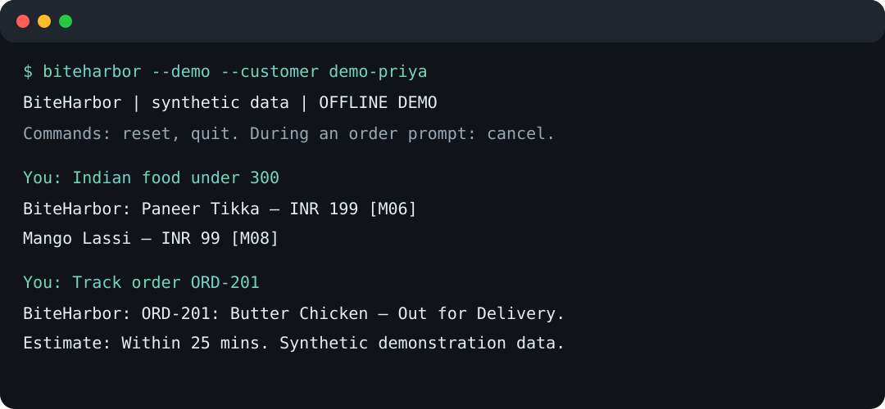
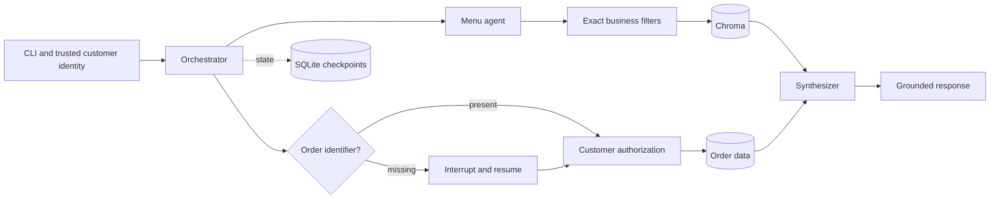

# BiteHarbor

[](https://github.com/tellanad/biteharbor-langgraph-food-assistant/actions/workflows/ci.yml)
[](https://www.python.org/)
[](LICENSE)

Grounded menu discovery and customer-scoped order support built with LangGraph, OpenAI, and
Chroma. BiteHarbor demonstrates a production-minded agent workflow in which models handle routing
and language while deterministic code enforces authorization, dietary constraints, prices, and
runtime limits.

> This repository contains synthetic menu and order data. It is an engineering demonstration, not
> a live ordering service, and it does not provide medical or allergy-safety guarantees.



## Why this exists

Food-delivery support has two different risk profiles. Menu discovery benefits from natural-language
search, but prices and dietary requirements must remain exact. Order tracking handles customer data
and must never trust an identifier alone. BiteHarbor combines both workflows in one graph without
giving the model authority over business rules or access control.

The intended outcomes are faster self-service, lower support volume, accurate catalog answers, and
zero cross-customer disclosure. These are documented as testable targets in the
[business case](docs/BUSINESS_CASE.md); the repository does not present unmeasured ROI as fact.

## What it demonstrates

- Structured-output routing to menu and order specialists
- Bounded tool-calling loops with timeouts, retries, and graph recursion limits
- Chroma semantic retrieval over a versioned menu collection
- Deterministic price, cuisine, availability, and dietary filtering before semantic ranking
- Customer-scoped order lookup with identical unknown and unauthorized responses
- LangGraph `interrupt()` and `Command(resume=...)` for missing identifiers
- Durable local checkpoints with SQLite and explicit conversation reset
- Offline demo and test doubles that require no API key or paid model calls
- CI linting and tests for routing, HITL, mixed intent, data correctness, and authorization

## Architecture



See [Architecture](docs/ARCHITECTURE.md) for trust boundaries, deployment changes, and design
decisions.

## Quick start

Requirements: Python 3.12 and [uv](https://docs.astral.sh/uv/).

```bash
git clone https://github.com/tellanad/biteharbor-langgraph-food-assistant.git
cd biteharbor-langgraph-food-assistant
uv sync --frozen --all-groups
uv run biteharbor --demo --customer demo-priya
```

Try these queries:

```text
hello
Show me vegan dishes
Indian food under 300
Where is my order?
Pizza options and track ORD-201
```

The offline demo uses deterministic fixture behavior. For the full LLM and vector-search path:

```bash
cp .env.example .env
# Add OPENAI_API_KEY to .env
uv sync --extra live
uv run biteharbor --customer demo-priya
```

### Web demo and Vercel

The repository also includes a FastAPI adapter and responsive portfolio UI. The public web path
uses deterministic synthetic fixtures, while the CLI retains the optional OpenAI-backed mode.

```bash
uv run uvicorn app:app --reload
```

Open `http://127.0.0.1:8000`, or inspect the API at
`http://127.0.0.1:8000/api/docs`. Deploy a preview with `vercel deploy`; the Vercel entry point is
declared in `pyproject.toml`.

Configuration is environment-based:

| Variable | Default | Purpose |
|---|---|---|
| `OPENAI_API_KEY` | none | Required in live mode |
| `BITEHARBOR_MODEL` | `gpt-4o` | Chat model |
| `BITEHARBOR_EMBEDDING_MODEL` | `text-embedding-3-small` | Catalog embeddings |
| `BITEHARBOR_DATA_DIR` | `.biteharbor` | Checkpoint and Chroma storage |
| `BITEHARBOR_TIMEOUT_SECONDS` | `30` | Provider request timeout |
| `BITEHARBOR_MAX_TOOL_ITERATIONS` | `5` | Tool-loop safety bound |

## Usage examples

Menu constraints are applied in code, so `Indian food under 300` returns Paneer Tikka and Mango
Lassi. A semantic model cannot quietly add an Italian dish or cross the price boundary.

Order lookup requires a caller identity supplied by the application boundary. `ORD-201` is visible
to `demo-priya`, while the same identifier presented as `demo-arjun` returns the same generic error
as an unknown order. The CLI customer flag is a fixture selector; a real deployment must replace it
with verified authentication claims.

## Quality checks

```bash
uv run ruff check .
uv run pytest
```

The test suite runs without an OpenAI key. GitHub Actions installs dependencies from `uv.lock`,
lints the codebase, and executes the suite for pushes and pull requests.

## Production readiness

This repository applies production-oriented controls at the application layer, but a public service
still needs an authenticated API boundary, rate limiting, managed secrets, encrypted production
storage, tracing, alerting, retention policies, and adapters for real catalog and order systems.
SQLite and the CLI are deliberate local-demo choices.

The [security policy](SECURITY.md) describes the trust assumptions. The
[business case](docs/BUSINESS_CASE.md) defines how impact should be evaluated before making public
claims.

## Repository layout

```text
src/biteharbor/
  backend.py       model boundary, RAG, and offline backend
  config.py        environment settings and model clients
  data/            synthetic menu and order fixtures
  domain.py        deterministic filters and authorization
  graph.py         LangGraph nodes, routing, HITL, and synthesis
  main.py          CLI and durable checkpoint lifecycle
  state.py         typed graph state and routing schema
  web.py           FastAPI adapter and public demo contract
app.py              Vercel entry point
web/                responsive browser client
tests/              offline unit and graph tests
docs/               architecture, demo, and business evaluation plan
```

## Contributing and license

See [CONTRIBUTING.md](CONTRIBUTING.md) for the development workflow. BiteHarbor is available under
the [MIT License](LICENSE).
