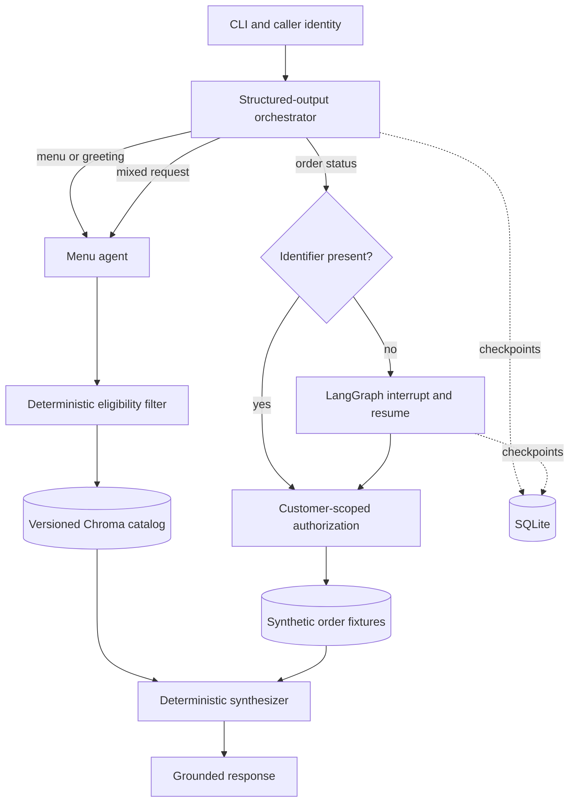

# BiteHarbor Architecture

## Design goals

BiteHarbor demonstrates how a food-delivery support workflow can combine model reasoning with
deterministic business controls. The model may route requests and phrase grounded answers. Python
code owns authorization, price and dietary filtering, iteration limits, and persistence.

## Trust boundaries

- User queries, identifiers, retrieved text, and model responses are untrusted.
- `customer_id` represents identity supplied by a trusted application layer. The CLI flag is only a
  fixture selector and must be replaced by real authentication in a deployed service.
- Order lookup returns the same error for unknown and unauthorized records and excludes customer PII.
- Exact price, cuisine, availability, and dietary rules run before semantic ranking.
- Model and tool loops have fixed iteration, timeout, retry, and graph recursion bounds.
- SQLite is suitable for this local demonstration. A multi-instance deployment should use a managed
  LangGraph checkpointer with retention and encryption policies.

## Runtime modes

`--demo` runs deterministic routing and responses without external services. The default live mode
uses structured output, tool calling, OpenAI embeddings, and a persistent Chroma collection. The
collection name includes a digest of the catalog and embedding model to prevent stale-index reuse.

## Production extension points

Replace fixture data with inventory and order-service adapters, replace the CLI customer selector
with authenticated claims, and add an HTTP boundary with rate limits and request tracing. Model
quality should be evaluated before rollout, and every business-impact statement should come from
measured production telemetry.
